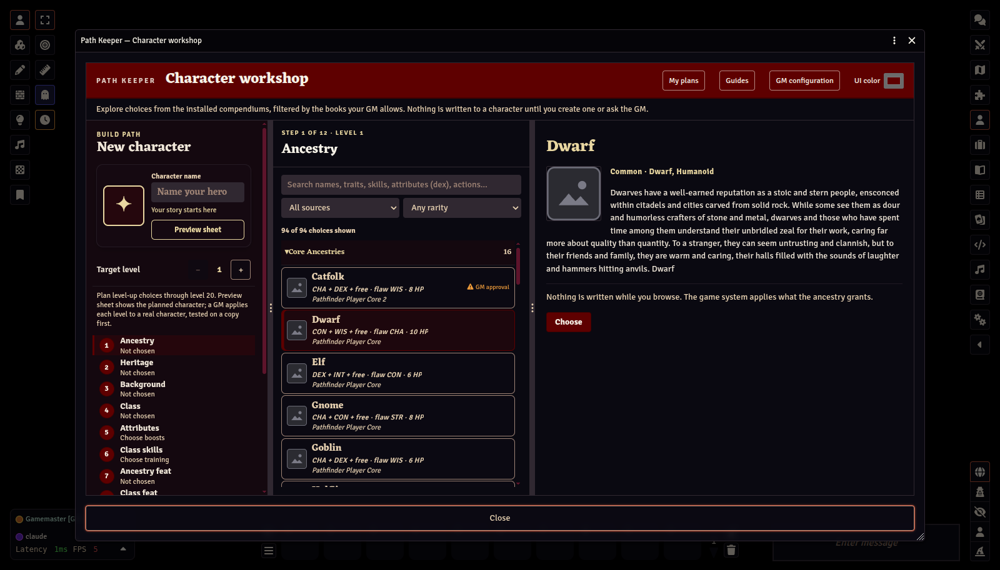

# Path Keeper

A character builder and level-up planner for [Foundry Virtual Tabletop](https://foundryvtt.com) 14 and the Pathfinder Second Edition (PF2e) and Starfinder Second Edition (SF2e) game systems.

## Install

In Foundry's Setup, open **Add-on Modules → Install Module**, paste this into **Manifest URL**, and click **Install**:

```
https://github.com/jadrian2006/path-keeper/releases/latest/download/module.json
```

Then launch your world and enable **Path Keeper** under **Game Settings → Manage Modules**. Foundry checks the same link for updates. It needs Foundry 14 with the Pathfinder Second Edition or Starfinder Second Edition system ([requirements](#requirements)); the files themselves are on the [latest release](https://github.com/jadrian2006/path-keeper/releases/latest) page.

## About

Players plan a character from level 1 to 20 in a guided workshop. The GM decides which books and rarities are allowed and approves what becomes a real character. Path Keeper reads the compendiums installed in your world and creates and levels characters through the game system's own item pipeline, so automatic grants, rule-element choices, and feat slots are applied by the system itself. It bundles none of the system's content.



## What it does

**For players**

- Build a character step by step: ancestry, heritage, background, class, attributes, skills, feats, class path and spells, starting equipment, and every later level's choices.
- Answer the game system's own rule choices (a Dwarf's clan weapon, a deity, a weapon group) before the character is created, with the options the system itself offers.
- Save any number of plans on your own Foundry account, export a plan as a file, or share one with someone online.
- Try a plan as a private sandbox character, if the GM allows it.
- Ask the GM to promote a plan into your real character, then apply each new level from the approved plan when you gain it. Every level is tested on a copy of the character first.
- Bring in a character you already play: Path Keeper reads it back as a plan from level 1 and checks it against the rules as it does.
- Ask to retrain, or to rebuild from level 1, a character already in play.

**For GMs**

- Choose the books players may build from (core rulebooks only by default), and how uncommon, rare, and unique options are handled: allowed, sent to you for review, or hidden.
- Trust a homebrew or third-party compendium as a whole, or allow single items request by request.
- Set starting coins, items, and kits; players can buy their starting gear against that budget.
- Review each request in a queue: see exactly what the plan picks, allow or refuse flagged items, approve, or send it back with a note the player sees.
- Open any player's plan to help, and send suggestions without changing their plan.
- Correct a character's items, and apply retraining or a rebuild in place, each tested on a copy before the character is touched.
- Switch off any of the few rules Path Keeper adds where the installed data is silent (each cites its book and page), and add house rules for extra spell slots.

Players never need permission to create actors. A character is created, retrained, rebuilt, or corrected on a GM's client, after the GM's checks; an approved level is applied by the character's owner or a GM.

## Requirements

| | Minimum | Verified with |
|---|---|---|
| Foundry Virtual Tabletop | 14 | 14.369 |
| Pathfinder Second Edition system (`pf2e`) | 8 | 8.7.0 |
| Starfinder Second Edition system (`sf2e`) | 1 | 1.7.0 |

One of the two systems is required. Starfinder content in a PF2e world (and the reverse) is supported through Paizo's official Anachronism modules.

When your world runs a newer system version than the verified one, nothing is blocked: the GM sees a notice once, and **GM configuration → System compatibility** can check the module's readers against your installed compendiums.

## Getting started

After installing or updating, return to Setup and launch the world once so the in-game guides load.

1. Open the **Actors** sidebar and click **Open Path Keeper**. The guide for your role opens beside the workshop.
2. As GM, click **GM configuration** in the workshop header. Choose the books players may use, the rarity rules, and the starting equipment.
3. Players build and save plans, then use **Request promotion** on the Review step.
4. The GM opens **Player build requests** in GM configuration and approves the request. The character is created for that player.
5. When the character gains a level, its owner right-clicks it, chooses **Open in Path Keeper**, and applies the next approved level.

The full guides ship inside the module as two compendiums (*Path Keeper Player Guide* and *Path Keeper GM Guide*) and are also in this repository, with screenshots: [docs/guide](docs/guide/README.md).

## Known limits

- At creation Path Keeper sets up what the class gives: the spellcasting entry, the starting spells, and the class's own level-1 focus spells. A spell that only an ancestry's or a feat's text grants, and rituals, may need adding on the sheet.
- A few things the game system's data does not record are listed on Level-up to set by hand, such as a Runesmith's new runes and a Summoner's Eidolon Transcendence.
- A rule choice that belongs to an item granted two or more steps away from anything the plan creates cannot be answered in advance. The game system asks it when the character is created, and the request is flagged for the GM.
- Voluntary flaws, Ancestry Paragon, Dual Class, and class kits chosen by the player are not handled. Free Archetype is.
- The organized-play preset is a starting point: boons and access are not in the compendium data.
- The interface is in English only.

See the GM guide's [troubleshooting page](docs/guide/gm/06-troubleshooting.md) for the current list.

## Reporting problems

Use the [issue form](https://github.com/jadrian2006/path-keeper/issues/new/choose). Include your Foundry and game system versions, the class and level, and the steps. Do not attach exported actors or world data.

## Source

Path Keeper's JavaScript ships unminified inside the release ZIP, under the MIT License. It has no runtime dependencies and makes no network requests. Development happens in a separate repository; this one holds the releases, the guides, and the issue board.

## Credits and licensing

Path Keeper is made by [jadrian2006](https://github.com/jadrian2006) and [Frodie](https://github.com/Frodie).

Path Keeper's code is released under the [MIT License](LICENSE). The few game rules it contains are ORC Licensed Material; see [ORC-NOTICE.md](ORC-NOTICE.md).

Path Keeper ships no artwork, and no rules text beyond a few cited rules adjustments credited in [ORC-NOTICE.md](ORC-NOTICE.md); everything else it shows comes from the PF2e/SF2e game system and Foundry at runtime. The guide screenshots replace the system's artwork with plain placeholders and flat colours.

Pathfinder, Starfinder, and associated marks are trademarks of Paizo Inc., used under Paizo's Community Use Policy. We are expressly prohibited from charging you to use or access this content. Path Keeper is not published, endorsed, or specifically approved by Paizo. The full notices are in [docs/CREDITS.md](docs/CREDITS.md).
