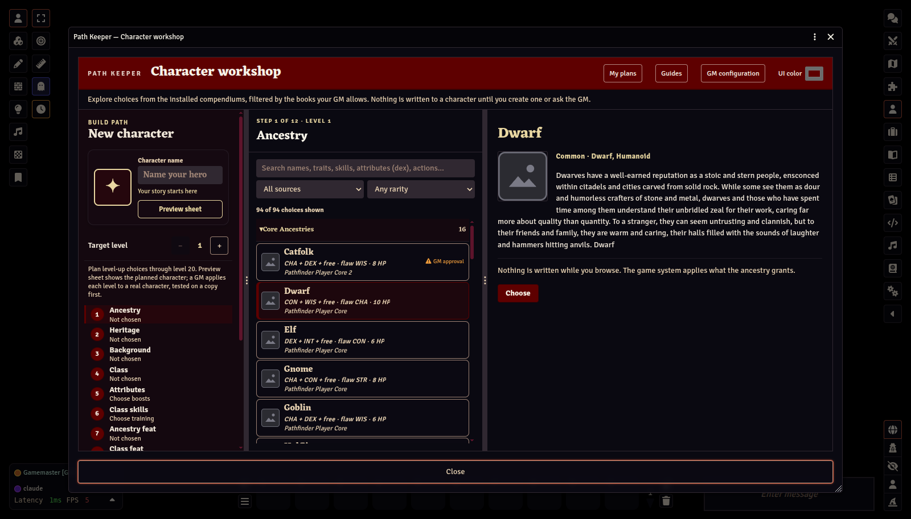

# Path Keeper guides

Path Keeper is a character builder for Foundry VTT 14 and the Pathfinder Second Edition (PF2e) and Starfinder Second Edition (SF2e) systems. It reads your installed compendiums at runtime and creates characters through PF2e's own item pipeline, so automatic grants, rule-element choices, and feat slots are applied by the system itself.

The same guides ship **inside the module** as two compendiums, so they are available in game:

| Guide | In Foundry | Who can open it |
|---|---|---|
| [Player Guide](player/README.md) | *Path Keeper Player Guide* compendium, or **Guides** in the workshop header | Everyone |
| [GM Guide](gm/README.md) | *Path Keeper GM Guide* compendium, or **Guides** in the workshop header | GMs only |

Every screenshot was captured from a live Foundry 14 / PF2e world on a plain black backdrop, so no scene art appears, and with every image the game system supplies replaced (portraits and icons by a plain placeholder, sheet backgrounds by a flat colour). These Markdown files are the single source of the text-only in-game journals. Screenshots remain in the repository guide and are not packaged in the module.
