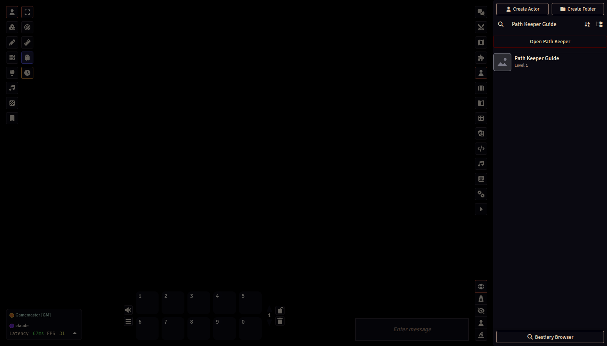

# Setting up Path Keeper

[← GM Guide contents](README.md)

## Requirements

- Foundry VTT **14**
- The **Pathfinder Second Edition** system, version 8 or later (verified with 8.7.0), or the **Starfinder Second Edition** system, version 1 or later (verified with 1.7.0)
- A GM account to install modules and change world settings

## Installing

1. In Foundry's Setup, open **Add-on Modules → Install Module**.
2. Paste Path Keeper's manifest URL into **Manifest URL** and click **Install**: `https://github.com/jadrian2006/path-keeper/releases/latest/download/module.json`
3. Launch the world, open **Game Settings → Manage Modules**, enable **Path Keeper**, and save.

> Foundry reads a module's compendiums from its manifest when a world launches. After installing or updating Path Keeper, **return to Setup and relaunch the world once** so the guides and settings load. A browser refresh is enough for later code-only updates.

## Opening Path Keeper

Open the **Actors** sidebar. Path Keeper adds a button to its header:

- **Open Path Keeper** opens the character workshop. Players and GMs both have this button. The guide for your role (this GM Guide, or the Player Guide for players) opens next to it the first time. After that, use **Guides** in the workshop header, or tick **Show this guide when I open Path Keeper** at the top of the guide to have it open every time. That choice is a per-user setting (**Open the guide with Path Keeper**), so it follows the person to any computer.
- **Player build requests** is in **GM configuration** inside the workshop. It opens the queue and shows a count while builds are waiting.

Character owners and GMs also get **Open in Path Keeper** on a character's right-click menu. It opens the character's home: the character as its sheet is now, section by section, with where each part comes from and anything against the rules shown in its section. Nothing there changes the actor; its **Open the workshop** saves a plan from the character, as importing always did. The home can also stage retraining changes (a class feat swap, a repertoire spell swap, class skill or Lore changes) and open them for review together; they reach the character only when a GM approves the retraining. See [Levelling up](05-creating-and-levelling.md).

## First steps for a GM

1. Open the workshop and click **GM configuration** in its header, or go to **Game Settings → Configure Settings → Path Keeper → Books, rarities, and defaults**.
2. Choose which books players may build from. Only the core rulebooks are on by default. See [GM configuration](02-configuration.md).
3. Set starting equipment. See [Starting equipment and kits](03-starting-equipment-and-kits.md).
4. Decide whether players may build sandbox characters, and review the [player request flow](04-player-requests.md).
5. Point players at the **Path Keeper — Player Guide** in the *Path Keeper Player Guide* compendium.

## Credits and licensing

Path Keeper shows names, descriptions, and icons read from the PF2e / SF2e game system installed in this world and bundles none of that content. The few rules adjustments it contains (each citing its book) are ORC Licensed Material, credited in the ORC Notice that ships with the module (ORC-NOTICE.md). The screenshots in this guide show Path Keeper's own interface, with every image the game system supplies replaced: portraits, icons, and logos by a plain placeholder, sheet backgrounds by a flat colour; the names in them are the installed system's data. Pathfinder, Starfinder, and associated marks are trademarks of Paizo Inc., used under Paizo's Community Use Policy; Path Keeper is not published, endorsed, or specifically approved by Paizo. Remaster rules text is published by Paizo under the ORC License; game data and icons come from the PF2e/SF2e systems for Foundry VTT; Foundry Virtual Tabletop and its icons are © Foundry Gaming LLC. The full notices are in ORC-NOTICE.md and the repository's docs/CREDITS.md.

Next: [Configuration →](02-configuration.md)
