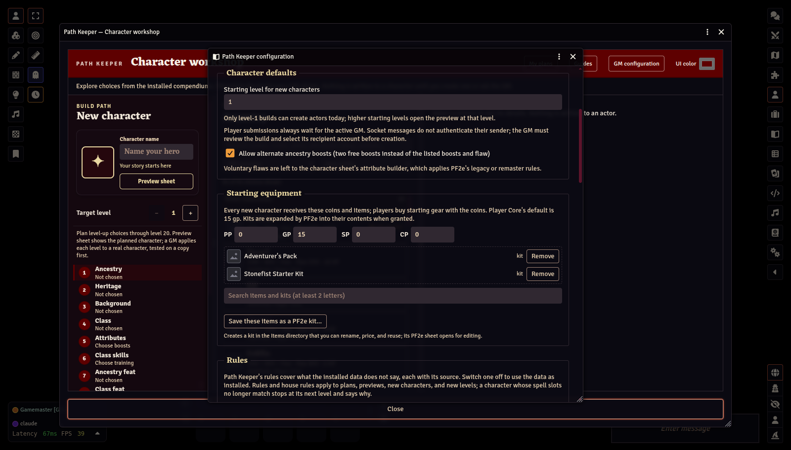
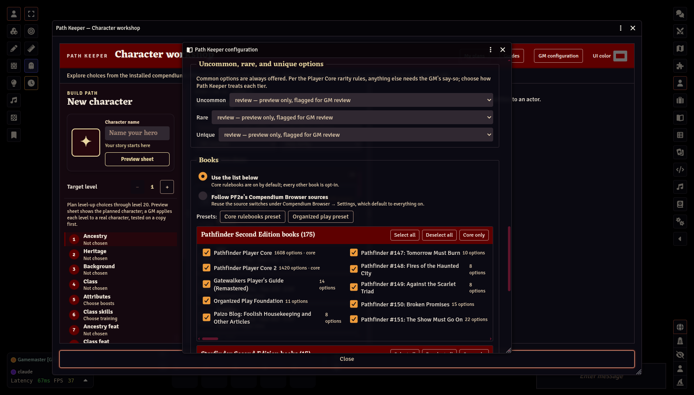
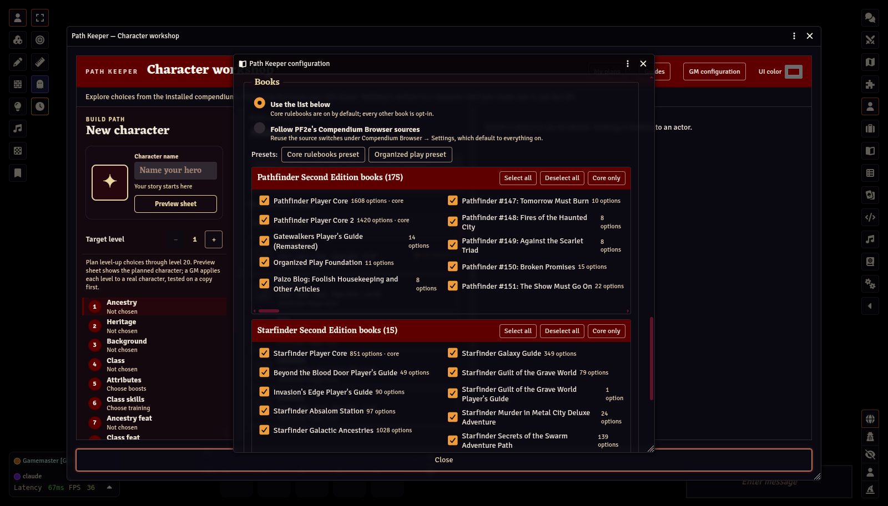

# Configuration

[← GM Guide contents](README.md)

Open it from the **GM configuration** button in the workshop header, or from **Game Settings → Configure Settings → Path Keeper → Books, rarities, and defaults**. These are world settings. They limit what Path Keeper offers and what it will write; they never change your compendiums. Click **Save configuration** at the bottom. Reopen the workshop to see the changes.

## System compatibility

The first section says which PF2e or SF2e version Path Keeper was verified with and which one this world runs. A newer system is never blocked — anything Path Keeper cannot read is refused item by item, with the reason — but the GM is warned once per new version at startup. **Run compatibility check** exercises the module's readers on the installed compendiums (backgrounds, classes, every caster's spellcasting text, the system's rule choices, spells) and lists which still read the data. Upgrade procedure: update the system on a test world first, run the check, then update the world your players use.

**Refresh Content** re-reads the installed choices, reloads open workshop lists, and reports class progression blockers. It lists contributing compendiums and shows which class and feat sources have options hidden by the saved source or rarity settings. The report describes what Path Keeper can read and does not certify that every class mechanic can be automated.

For a GM Script macro, use this command to print the report in the browser console:

```js
console.log(await pathKeeperLab.refreshPf2eContent());
```

## Character defaults



- **Starting level for new characters.** The workshop opens at this target level. A character is always created at level 1; a higher starting level opens the plan at that level, and its later levels are applied as the character gains them.
- **Allow alternate ancestry boosts.** Lets players take two free boosts instead of the ancestry's listed boosts and flaw (*Player Core*). On by default.

Sandbox characters, their per-player limit, and whether players' characters need your approval are set in **Game Settings → Configure Settings → Path Keeper**. By default every promotion needs your approval; see [Player requests](04-player-requests.md).

## Starting equipment

Coins and items every new character receives. See [Starting equipment and kits](03-starting-equipment-and-kits.md).

## Rules

Path Keeper ships a few rules for what the installed data does not say, each with its source (for example, a Cleric's Divine Font slots, or a school Wizard's curriculum cantrip). Each has a switch: turn one off to use the data as installed.

**House rules** add extra spell slots to a caster's main list: for every caster or one class, from a level on, of a given rank (or the highest rank the character has), one to three slots, with a note saying why. Rules and house rules apply to plans, previews, new characters, and new levels, and the workshop's Review lists the ones a plan uses. Characters built before a change keep their slots; at their next level, Path Keeper stops and says the slots differ.

## Uncommon, rare, and unique options



Common options are always offered. Under the *Player Core* rarity rules, anything else needs the GM's say-so. For each tier choose:

| Setting | Effect |
|---|---|
| **allow** | Offered like a common option and can be used to create a character |
| **review** | Shown with a **review** marker; can be previewed but not used to create a character |
| **deny** | Hidden from every step |

Defaults: uncommon and rare are **review**, unique is **deny**.

## Books



Path Keeper lists every book that has ancestries, heritages, backgrounds, classes, feats, or spells in your visible compendiums, grouped into three boxes:

- **Pathfinder Second Edition books**
- **Starfinder Second Edition books.** In a PF2e world these come from the official *Starfinder Anachronism* module; in an SF2e world they are the system's own books, and Pathfinder books come from the official *Pathfinder Anachronism* module. Path Keeper treats both official modules as first-party content, not as added sources. Under the rules, Starfinder 2e and Pathfinder 2e content are compatible at the GM's discretion.
- **Other installed sources.** World items and third-party modules.

Each box has **Select all**, **Deselect all**, and **Core only**. The core rulebooks (*Pathfinder Player Core*, *Player Core 2*, and *Starfinder Player Core*) are on by default. **Every other book is opt-in.** A book that is off is hidden from every workshop step and cannot be used to create a character.

Instead of this list, you can choose **Follow PF2e's Compendium Browser sources** to reuse the source switches in PF2e's Compendium Browser settings. Those default to everything on.

### Trusted compendiums

Below the books, **Trusted compendiums** lists every Item compendium from your world or from a module other than the game system and Paizo's *Anachronism* modules, grouped by module. Tick **Trusted** for the ones whose content your table uses, or **Trust all packs in this module**. A compendium that appeared since you last saved is marked **New**; none is trusted until you tick it.

- **A pick from a trusted compendium** needs no separate Allow for where it comes from. Trust covers items added to it later, so adding your own homebrew feat or spell needs no Path Keeper update and no ticket to anyone.
- **A pick from an untrusted compendium** can still be planned and sent: it reaches you in the queue as an item to **Allow**.
- **Books still decide.** A book you turned off stays off, trusted compendium or not. A book you never decided on is on for a trusted compendium's items; its row then reads *on (trusted pack)*. Untick it to turn it off.
- **Rarity and approval still apply.** Uncommon, rare and unique follow the settings above, and player changes still come to you for approval.
- **If a compendium goes missing** after a player sent a request, approving it changes nothing: the request goes back to the queue naming the compendium. Restore it, then approve again.

### Presets

- **Core rulebooks preset** restores the defaults above.
- **Organized play preset** approximates organized play: every book of your system's own line on, the other line and third-party sources off, uncommon set to review, rare and unique hidden. Boons and access are not recorded in compendium data, so treat this as a starting point, not a legality check.

Next: [Starting equipment and kits →](03-starting-equipment-and-kits.md)
