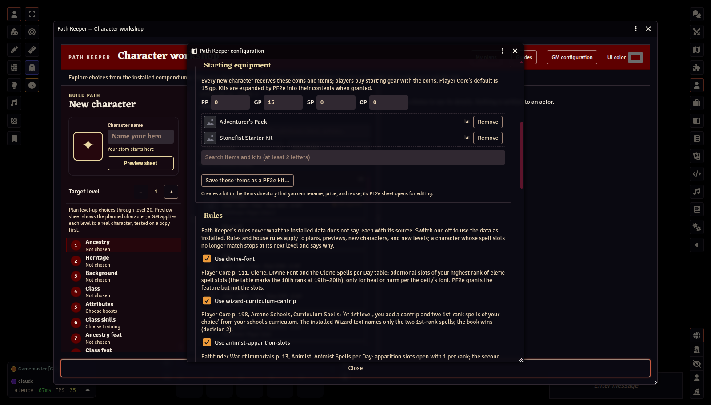
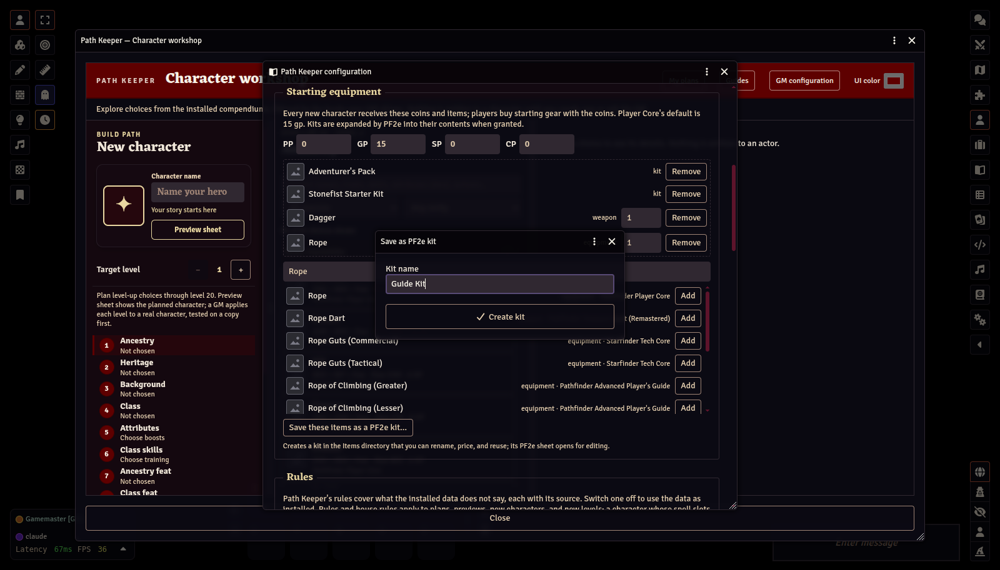
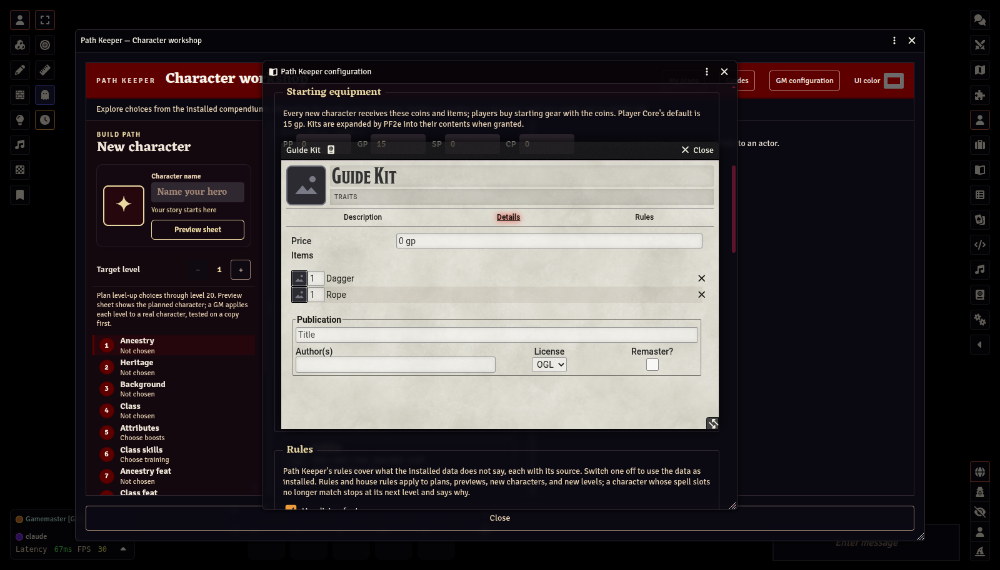
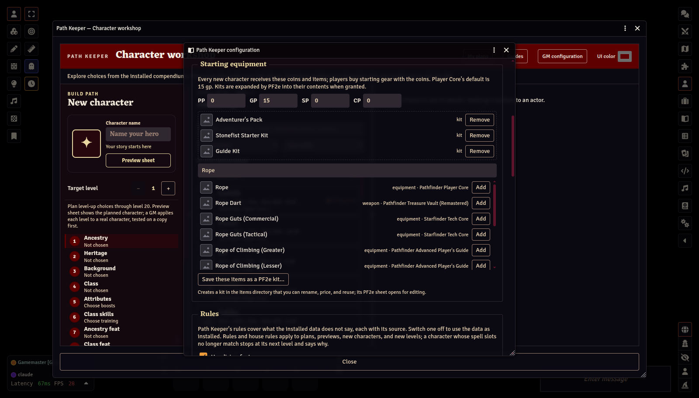
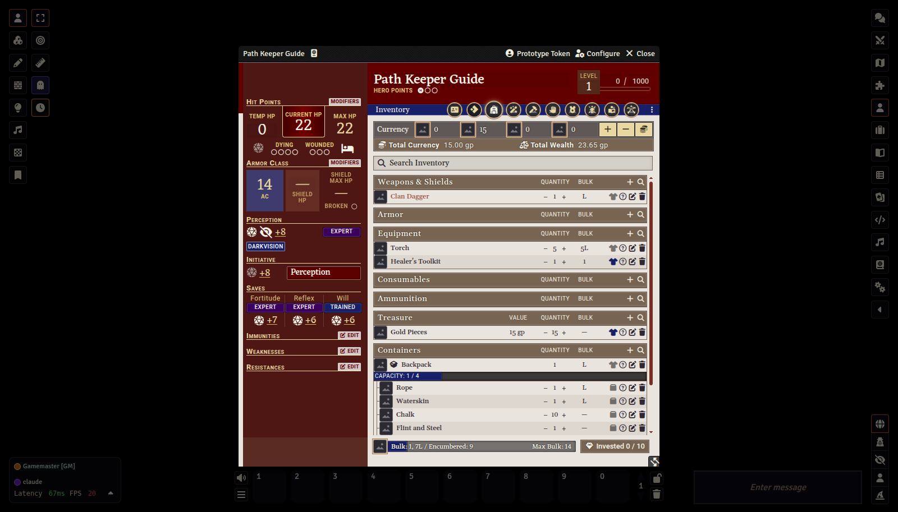

# Starting equipment and kits

[← GM Guide contents](README.md)

Every new character, whether created by the GM or from a player's request, receives the starting equipment set in **GM configuration → Starting equipment**. On the workshop's **Equipment** step a player can also spend the starting coins on gear; whatever is not spent stays with the character as coins. Your computer prices and checks those purchases again when the character is created, and an item from an added source or of a rarity you review waits for your **Allow** on the request.

## Coins

Set platinum, gold, silver, and copper pieces. *Player Core* gives a new level-1 character **15 gp**, which is the default.

## Granted items

- **Search.** Type at least two letters in the search box to find items and kits in every visible compendium and in your world's Items directory, then click **Add**.
- **Drag and drop.** Drag an item or kit from a compendium or the Items directory onto the list.
- **Quantity.** Adding the same item again raises its quantity. Kits always count as one.
- **Remove** takes an entry off the list.

PF2e's own kits, such as the *Adventurer's Pack* above, can be granted like any other item.

## Building a kit

**Save these items as a PF2e kit…** turns the loose items in the list into a real PF2e kit.

The kit is created in your **Items** directory and its PF2e sheet opens. Its **Details** tab lists the contents and quantities; you can rename it, set a price, and edit its contents there like any PF2e kit.

The kit replaces those loose items in the starting equipment. Remember to **Save configuration**.

Because it is a normal PF2e kit, you can also reuse it anywhere, for example by dragging it onto a character sheet.

## What the character receives

When a character is created, coins and items are added with PF2e's own inventory functions, and PF2e expands each kit into its contents, including containers and kits inside kits, exactly as dropping the kit on the sheet would.

If an item on the list has since been removed from your compendiums, it is skipped with a warning and the character is still created.

Next: [Player requests →](04-player-requests.md)
