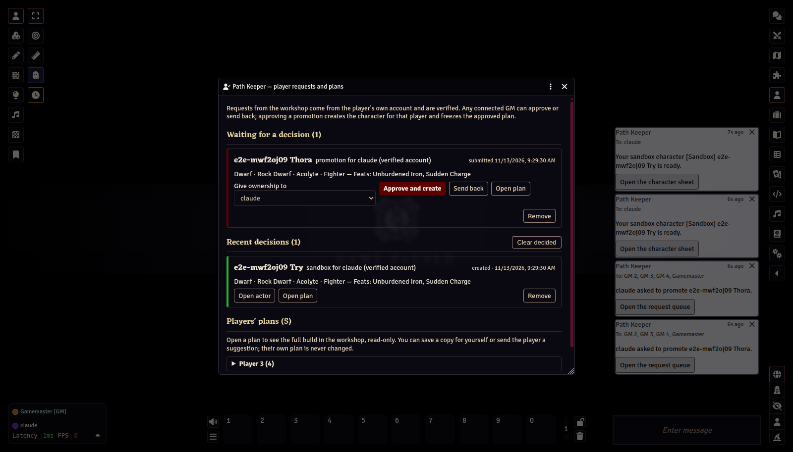
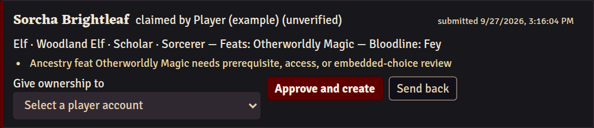
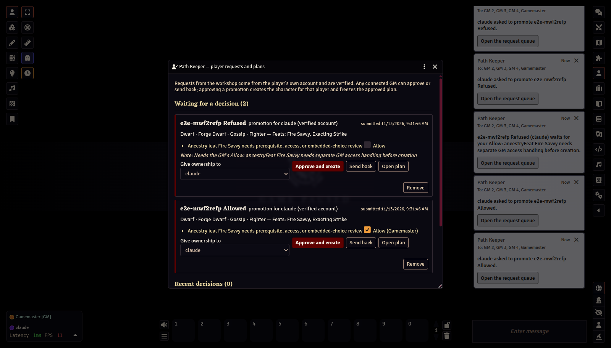
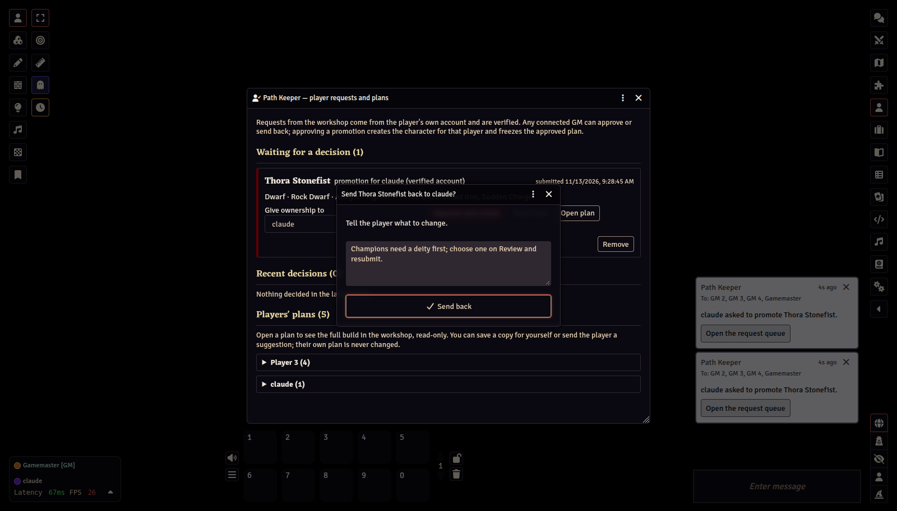
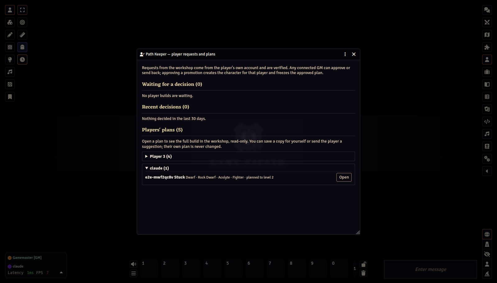
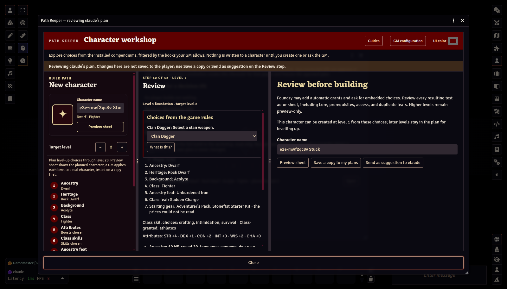
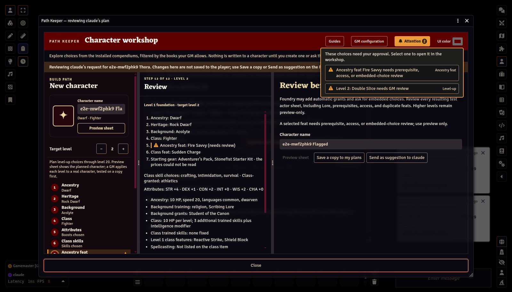

# Player requests

[← GM Guide contents](README.md)

Players build characters as plans and send two kinds of request from their own Foundry account: **sandbox** characters (private practice copies) and **promotion** into a real character. Because a request is written to the player's own user record, which only that player can change, the sender is verified.
## The request queue

Open the queue from the workshop: **GM configuration**, then **Player build requests**. The button shows a count while builds are waiting. When a request arrives you also get a whispered chat card with an **Open the request queue** button, and the player gets a card with **Open the character sheet** when you approve.

- Requests made from the workshop show **(verified account)**: they came from that player's own Foundry account. **Approve and create** creates the character for that player — the recipient is fixed — and records the approved plan. Only the active GM's client can approve and create.
- Requests shown as **(unverified)** were made by the older socket method. For those, choose a player account yourself in **Give ownership to** after confirming the intended player with your group.

- **Send back** asks for a note. The player is notified with your note.
- The yellow notes under a request list every choice that needs your approval. Your client works them out from the submitted plan; nothing the player's client claims is trusted.
- Each note about content you can allow — an uncommon or rare item under a "review" rarity policy, an item from a book outside the allowed list, a feat whose prerequisite Path Keeper could not read — carries an **Allow** tick. Tick it and **Approve and create** accepts that exact item for this build; leave it and creation refuses the request with the reason, as before. The tick shows who allowed it, any connected GM may tick, and the allowance is kept with the approved plan for later level-ups. An item hidden by a "deny" rarity policy cannot be allowed here; change the policy instead. Notes about a choice only the game system can settle at creation have no tick.

- **Open plan** shows the build exactly as the player submitted it, in the workshop, read-only.
- **Players' characters need no GM approval** (in **Game Settings → Configure Settings → Path Keeper**, off by default) creates a promotion as soon as it arrives, through the same checks as one you approve, and records its approved plan. A request with anything for you to decide (a note with an **Allow** tick, a choice only the game system can settle) still waits in the queue. A GM must be connected for the character to be created.
- **Remove** takes a request out of the queue, and **Clear decided** empties Recent decisions. Characters already created and their approved plans are kept.
- **Recent decisions** keeps the last 30 days, including sandbox characters built automatically.

## Helping a player with a plan

When a player is stuck, or asks you to look, you can open any of their saved plans without waiting for a request. **Players' plans** at the bottom of the queue window lists every player who has saved one.

**Open** loads the plan in the workshop in review mode. A banner says whose plan it is, and nothing you change is saved to the player.

The Review step offers two actions instead of the usual ones:

- **Save a copy to my plans** keeps the build on your own account.
- **Send as suggestion to** the player adds a new plan to their My plans, named after theirs with **(GM suggestion)**. The player is notified. Their own plan is never changed. The player sees exactly what you changed: My plans lists the differences under the suggestion, and the workshop marks the steps involved with a blue Suggestions token beside the yellow Attention one.

### The Attention button

In review mode, as for the player, a yellow **Attention** button in the workshop header lists the choices that need your approval. Each build-path step and level-up slot that holds one carries a yellow mark. Select an entry to open that step.

Which choices need you comes from **GM configuration** and the data itself: rarities you set to review, content from added modules, and prerequisites PF2e's data cannot check. Books you turned off are hidden, so they never appear here. See [Configuration](02-configuration.md).

## Retraining and rebuilding

A player can right-click a character, choose **Open in Path Keeper**, then **Open the workshop**, then use **Character options** in the workshop to ask to **retrain** it or **rebuild** it from level 1. The request shows each change; for a retraining, also the downtime it takes (a week per feat, skill, or repertoire spell; a class feature's choice is yours to time, a month or more for a large one, Player Core, Retraining). **Approve and apply** changes the character in place: your client reads the character back from level 1, refuses a retraining that changes what cannot be retrained (ancestry, heritage, background, class, attribute boosts), builds the new plan in memory, tests it on a copy, and applies it. The character stays the same actor with its inventory, coins, notes, and the spells it prepared today; the plan becomes its approved plan. If anything comes out differently from the plan, the character is put back as it was and the request says why.

You can do the same yourself from the workshop's **Character options**: **Rebuild from level 1** opens its plan with every step open, for corrections or a revamp; Review's **Save and rebuild … now** applies it.

## Approved plans are frozen

Approving a promotion stores a copy of the plan where only GMs can change it. That copy is what later level-ups for the character use. If the player edits their plan afterwards, the change needs a new approval.
## Settings

In **Game Settings → Configure Settings → Path Keeper**:

| Setting | Default | Effect |
|---|---|---|
| **Players may build sandbox characters** | off | Allows **Build sandbox** for players |
| **Sandbox characters per player** | 10 | Further sandbox requests are refused until the player deletes one |
| **Players' characters need no GM approval** | off | A player's new character is created as soon as a GM is connected, through the same checks as an approved one. Anything for the GM to decide still waits in the queue. The approved plan covers every level the player planned, so leave this off if you want to see each plan first |
| **Ask the GM about rare, homebrew, and out-of-book items on imported characters** | off | On: importing a character that has such items waits for you. Off: such items do not hold up an import. Either way, a character with anything against the rules opens as a rebuild with those picks marked |

Next: [Creating and levelling characters →](05-creating-and-levelling.md)
