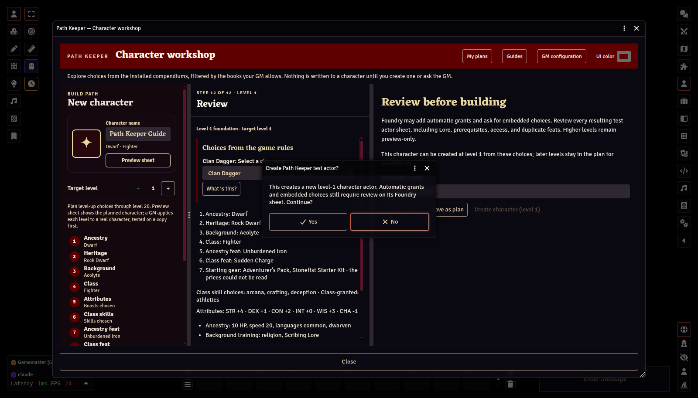
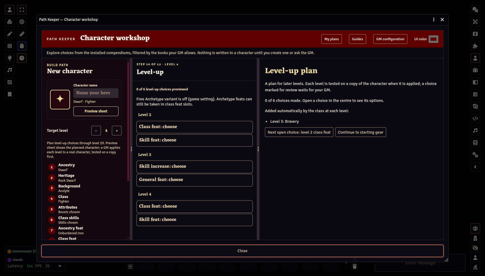
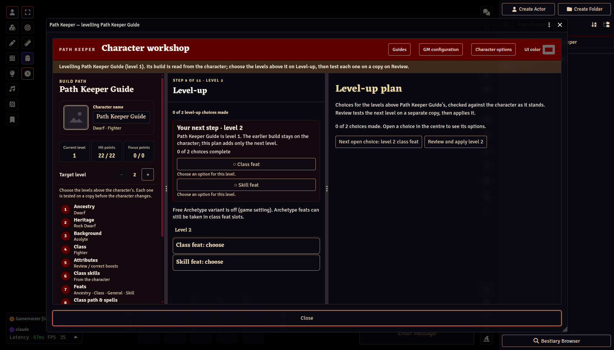

# Creating and levelling characters

[← GM Guide contents](README.md)

## Creating characters yourself

As GM you can build a character in the workshop and click **Create character (level 1)** on the Review step. It is created immediately, through the same checks as a player's promotion.

## Previewing advancement in the workshop

Raise the **Target level** in the build path (up to 20), then open the **Level-up** step. It opens on an overview of every level's choices: class feats, skill feats, general feats, ancestry feats, skill increases, the attribute boosts at levels 5, 10, 15, and 20, a caster's new spells, and the choices a class feature brings at its level (a Fighter's weapon mastery group). The slots come from PF2e's own feat groups, so variant rules such as **Free Archetype** add their slots automatically. Select a choice to list its options in the middle pane; simple prerequisites are checked, and anything else is marked for review.

**Preview sheet** on Review opens the planned character at its target level on the character sheet, each level applied the way a real level-up is, without creating anything.

This preview is for planning. Except for the level-2 test character described below, it does not write anything.

## Level-2 test characters

With a target level of **2**, the Review step offers **Create level-2 test actor** for classes whose level 2 is a plain class-feat and skill-feat slot. It creates a new, separate character; it never changes an existing one.

## Applying a character's planned levels

A character created from an approved plan can be raised to that plan's levels, by you or by the character's owner. Right-click it in the Actors directory and choose **Open in Path Keeper**, then **Open the workshop**, then **Character options → Apply approved level** in the workshop; that choice appears while the approved plan has a level beyond the character's. Players level their own characters this way, from the plan you approved, without a GM online.

The window lists the next level's planned decisions, then **Test level N on a copy**: the level is built from the plan as you approved it, applied to a separate copy kept in memory (so a player needs no permission to create actors, and nothing is left in the world), and checked (class features and their choices, feats, spells and slots, hit points). Only if the copy passes is the same level applied to the character, after confirmation. Repeat for each level. If a level cannot be applied, the window says why, for example a choice the plan has not made yet.

Some of a level is not stored by the game system, so Path Keeper cannot write it: a Runesmith's new runes (PF2e has no rune items), and a Summoner's Eidolon Transcendence at 17 (the eidolon is a separate actor). The level is still applied, and the confirmation lists what to record on the sheet by hand.

The approved version is used even if the player has changed the plan since; approve the new version to use their changes.

## Plans for characters players already have

A player can import a character they own (My plans → **Import a character**) and ask you to approve a plan for it. The request appears in the queue as a **levelling plan** for that character; **Approve plan** records the plan for the character (nothing is created), and its owner can then apply its levels. In My plans, a GM can approve a linked plan directly with **Approve for …**.

## Levelling up an existing character

Right-click a character in the Actors directory and choose **Open in Path Keeper**. Its home shows the character as its sheet is now, by section, with any rules findings in place. **Open the workshop** there reads it as a saved plan without changing the character.

A character must follow the rules to be imported. Path Keeper checks the sheet first (feat slots and what each takes, prerequisites at the level each feat was taken, the dedication rule, repeated feats, trained skills and skill increases, languages, attribute boosts, and the kind of spell list) and lists what is against the rules. **Open in Path Keeper to fix these** (for you, or the character's owner) opens it as a rebuild from level 1 with each pick that is against the rules marked in red; Review lists what the sheet had. The rebuild is applied, or sent to you for approval, only when the character it makes follows the rules: Path Keeper builds it in memory and checks it as it checks an import, and checks the test copy again before the character changes. Correcting the sheet and importing again works too. Archetypes are read from the system's Archetypes journal, so an archetype's Additional Feats fill its Free Archetype slots at the listed level.

Some items are legal only with your say-so: an uncommon or rare item your Path Keeper settings send for review, a book they leave out, an item made in the world rather than taken from a compendium, or a bonus feat nothing on the character grants. By default they do not stop an import, as suits characters from a game already running. To check them, turn on **Ask the GM about rare, homebrew, and out-of-book items on imported characters** in the module settings: a player then cannot import such a character, and you can, with **Import, allowing these**.

Installed third-party Item compendiums can provide choices when your source settings allow them. If an imported character already has an item from an unavailable compendium, Path Keeper names the missing pack and affected items before import. The embedded items stay on the character; a missing module is a warning, not by itself a rules violation. Install and enable the source module to browse, verify, or re-add its choices. Until then, review those items on the Foundry sheet and use the current-level import if Path Keeper cannot replay the complete build from level 1. A genuinely wrong feat slot or unmet prerequisite is still reported separately and must be corrected.

When it can reproduce the build from level 1, the plan opens in the workshop; raise its target level to plan ahead. If the build cannot be reproduced exactly, Path Keeper explains why and offers to import the character at its current level instead.

For a current-level import, the workshop opens for that character. Click its ancestry, heritage, background, class, attributes, skills, feats, or class path to inspect what its sheet currently records. Those views are read-only; **Level-up** lists the choices of the levels above its current level, with the options in the centre and details on the right, as when planning. Choose the next level's feats, skill increase, spells, and anything its class features ask.

Then open **Review** and select **Test level N on a copy**:

1. The level is first applied to a separate **copy**, and Path Keeper checks it: class features and their choices, feats, spells and slots, hit points.
2. Only then are you asked whether to apply the same level to the character. The copy is removed afterwards.
3. The workshop reads the character again and carries on with the next level.

If a level cannot be applied, Review says why, for example a choice not made yet, or spell slots on the character that differ from what its class gives at that level. Back up important characters before levelling them.

## Correcting a character

A GM can correct a character without a rebuild. Right-click it, choose **Open in Path Keeper**, then **Open the workshop**:

- **Attributes** (the step reads **Review / correct boosts**): change which attributes a boost went to.
- **Class path & spells**: stage spells to add or remove. This does not work out how many spells the build should know.
- **Equipment** (or **Character options → Correct items**): stage items to remove or add, and change quantities.

Each correction is staged first, then tested on a separate copy of the character. You see the result and confirm before the character changes; if anything fails, the character is put back as it was.

Next: [Troubleshooting →](06-troubleshooting.md)
