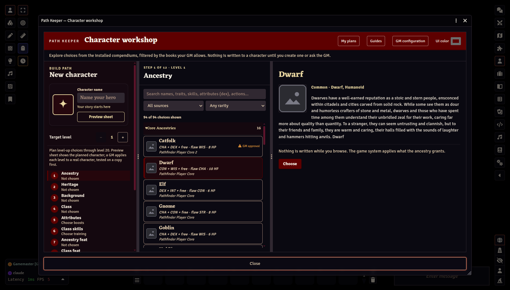

# Welcome to Path Keeper

[← Player Guide contents](README.md)

Path Keeper is a character builder for Pathfinder Second Edition and Starfinder Second Edition inside Foundry. It reads the books your GM has allowed and builds characters through the game system's own rules, so everything the system adds automatically is applied for you.

## Opening Path Keeper

Open the **Actors** sidebar and click **Open Path Keeper**. This guide opens next to the workshop. When you no longer need it, untick **Show this guide when I open Path Keeper** at the top of the guide; the **Guides** button in the workshop header still opens it any time, and ticking the box again turns it back on.

## What you can do

- **Build and browse freely.** Nothing is written to Foundry while you explore. See [Building a character](02-building-a-character.md).
- **Save plans** all the way to level 20, and keep as many as you like. See [Plans, sandbox characters, and promotion](04-plans-sandbox-promotion.md).
- **Try a plan as a sandbox character**, if your GM allows it: a private, playable copy that only you and the GM can see.
- **Ask the GM to promote** your favourite plan into your real character.

You never need permission to create actors in Foundry. Characters are always created on the GM's computer.

## Credits and licensing

Path Keeper shows names, descriptions, and icons read from the PF2e / SF2e game system installed in this world and bundles none of that content. The few rules adjustments it contains (each citing its book) are ORC Licensed Material, credited in the ORC Notice that ships with the module (ORC-NOTICE.md). The screenshots in this guide show Path Keeper's own interface, with every image the game system supplies replaced: portraits, icons, and logos by a plain placeholder, sheet backgrounds by a flat colour; the names in them are the installed system's data. Pathfinder, Starfinder, and associated marks are trademarks of Paizo Inc., used under Paizo's Community Use Policy; Path Keeper is not published, endorsed, or specifically approved by Paizo. Remaster rules text is published by Paizo under the ORC License; game data and icons come from the PF2e/SF2e systems for Foundry VTT; Foundry Virtual Tabletop and its icons are © Foundry Gaming LLC. The full notices are in ORC-NOTICE.md and the repository's docs/CREDITS.md.

Next: [Building a character →](02-building-a-character.md)
