# Building a character

[← Player Guide contents](README.md)

The workshop has three panes. The **build path** on the left lists the twelve steps and what you chose in each. The middle pane lists the choices for the current step. The right pane shows details for whatever you select, with the button that takes it. Steps with several decisions (Class path & spells, Level-up) open on an overview in the middle pane: select an item to list its options there, and the **←** row at the top returns to the overview. The window can be resized from its bottom-right corner, and each pane scrolls on its own.

Nothing is written to Foundry while you browse. You can move between steps freely; a step that needs earlier choices tells you what is missing.

This walkthrough builds a Dwarf Fighter.

## Choices that need your GM: the Attention button

Some choices are allowed only with your GM's approval. Examples are an uncommon ancestry, a feat whose prerequisites PF2e cannot check, or content from an added module. Path Keeper marks each of these with a yellow warning sign:

- on the option in the list, labelled **GM approval**;
- on the build-path step that holds it, and on a level-up slot;
- on its row in the Review summary.

When a build has any, a yellow **Attention** button with a count appears in the workshop header. Select it to see the list. Select an entry to jump to that step; for a level-up pick, the slot is selected for you.

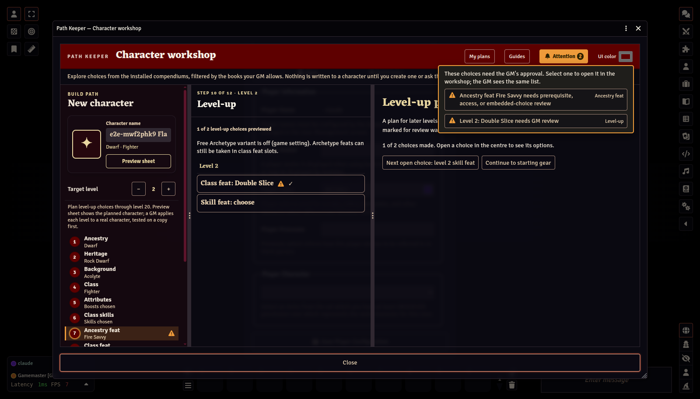

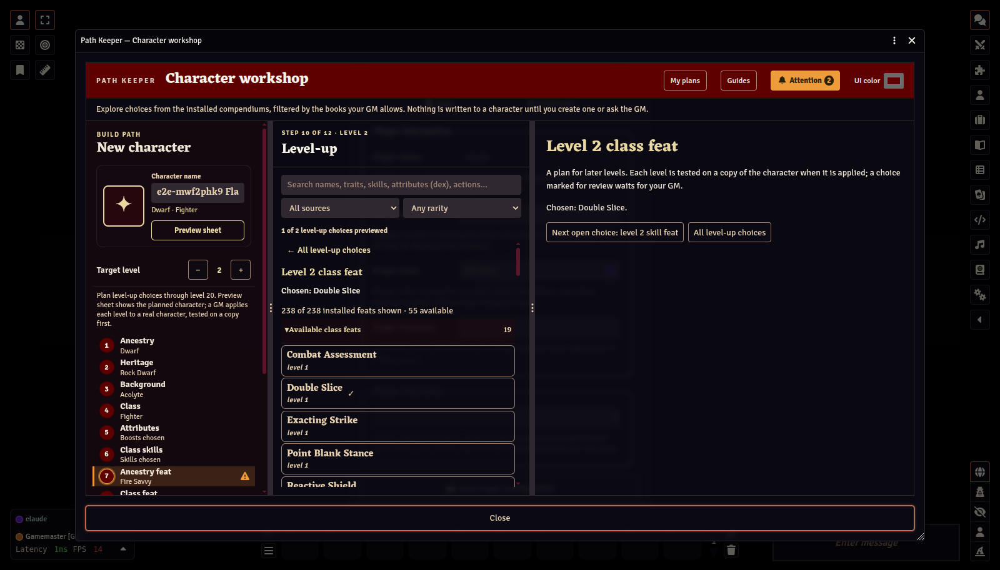

These choices are not errors. Your GM sees the same list when reviewing your plan or request, so you can talk it over. Path Keeper still checks the GM's book and rarity settings when the character is created.

## 1. Ancestry

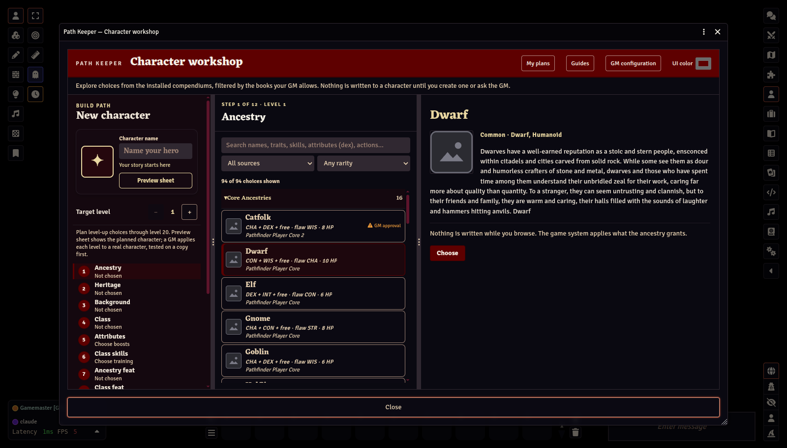

Choices come from the installed PF2e compendiums, filtered by the books your GM allows. Core rulebook choices are grouped first. Click an entry to read it, then **Choose** to choose it.

## 2. Heritage

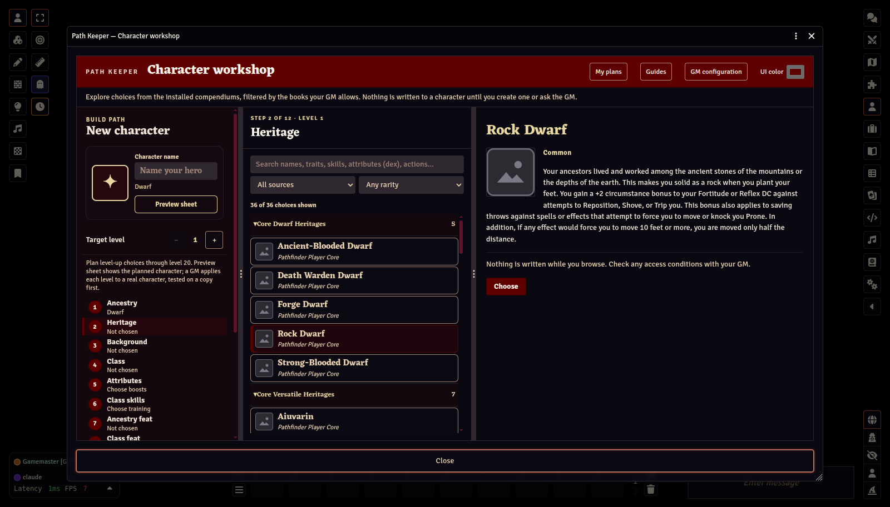

The list shows heritages for your ancestry, plus versatile heritages, grouped by book.

## 3. Background

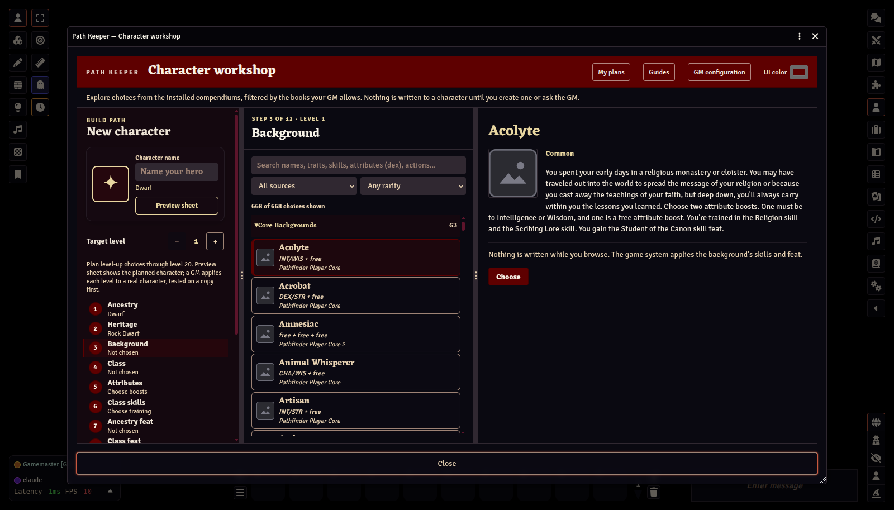

## 4. Class

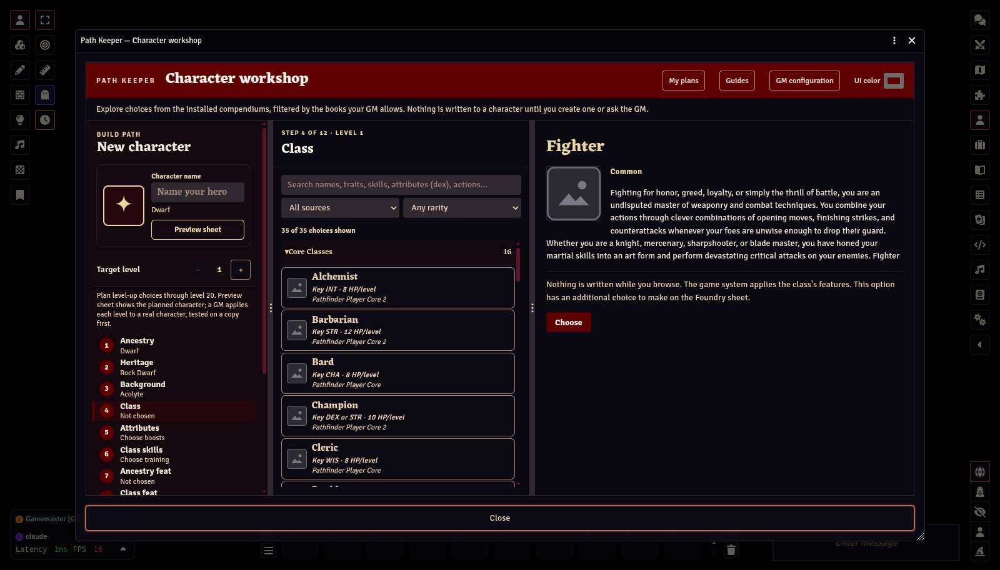

## 5. Attributes

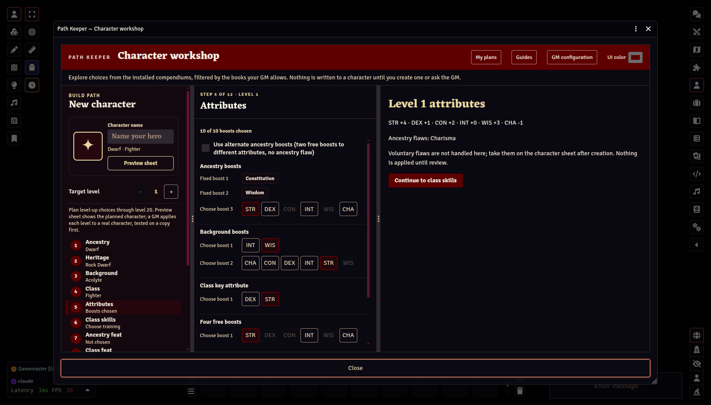

Fixed boosts are filled in for you. Choose the rest: ancestry, background, your class's key attribute, and four free boosts. Within each group an attribute can only be boosted once, so already-used options are dimmed. The right pane shows the resulting modifiers.

If your GM allows it, tick **Use alternate ancestry boosts** to take two free boosts to different attributes instead of your ancestry's listed boosts and flaw, as described in *Player Core*.

Voluntary flaws are not offered here. PF2e's own attribute builder on the character sheet handles them after creation.

The same step asks for your additional languages, one per point of Intelligence plus any your ancestry gives. You can choose from your ancestry's list and from the languages this world treats as common; an uncommon language needs your GM's permission.

## 6. Class skills

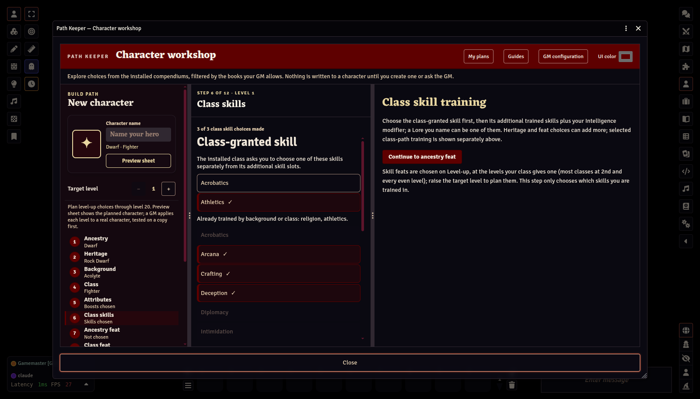

Skills already trained by your background or class are listed separately. If your background trains a skill your class already trains, you get one more choice here, as Player Core says. If your class lets you pick one granted skill (the Fighter chooses Acrobatics or Athletics), that choice appears first. Then choose the number of additional skills your class and Intelligence allow. A Lore can be one of them: type its name under **Or train a Lore** (for example *Sailing Lore*); select it again to remove it.

## 7. Ancestry feat

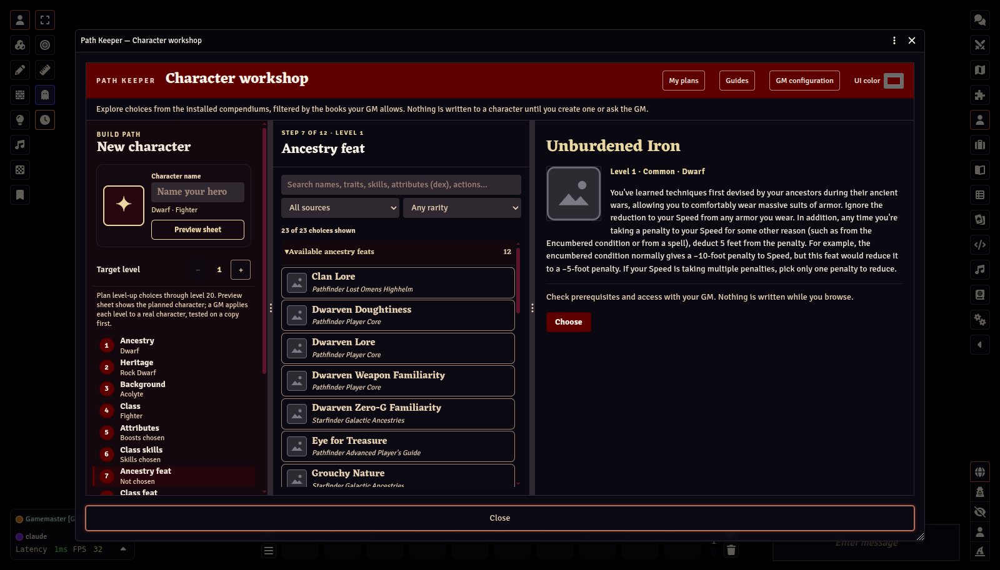

Only level-1 feats for your ancestry and heritage are listed. A feat whose prerequisites, rarity, or source need your GM's review is marked **review** and can be previewed but not used to create a character until the GM allows it.

## 8. Class feat

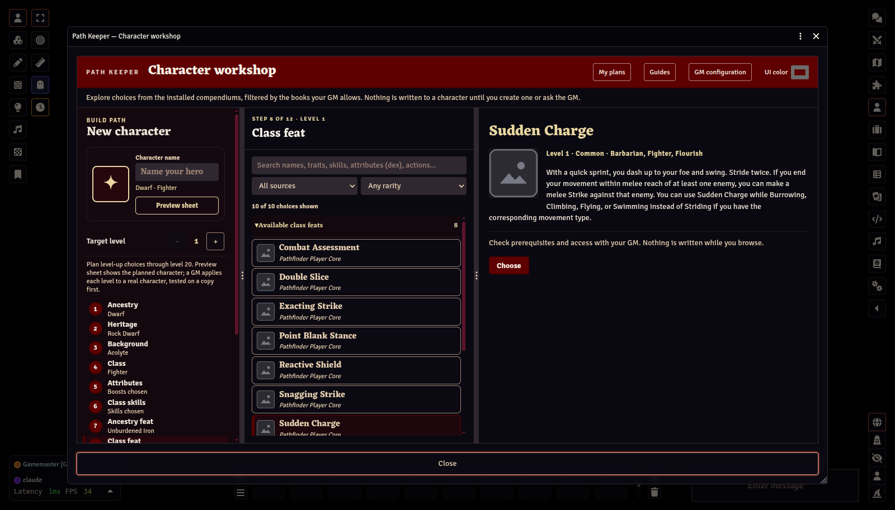

Shown only if your class gets a class feat at level 1.

## 9. Class path & spells

The step opens on an overview of what it asks: the class path (a Rogue's racket, a Barbarian's instinct, a Cleric's doctrine), any limited spell picks the path brings (a school's curriculum, a Witch's hex, an Animist's apparitions), and the spells. Select an item to list its options in the middle pane; select an option to read it on the right, then **Choose class path** (or **Add**) takes it. A class path chosen here is already answered on the Review step. A class with nothing to choose at level 1, such as a Fighter, passes straight through.

For a spellcaster, the step reads the class's own level-1 features and shows what they say: the tradition, whether spells are prepared or spontaneous, the spellcasting attribute, and the level-1 slots. What you then choose depends on the class:

- **Prepares from a spell list** (Cleric, Druid): nothing to choose now; spells are prepared on the character sheet each day.
- **Spellbook or familiar** (Wizard, Magus, Witch, Necromancer): choose the starting cantrips and rank 1 spells from the **Starting spellbook** (or familiar) item on the step's overview. A spell the class grants automatically is added for you.
- **Repertoire** (Bard, Oracle, Psychic, Summoner, Mystic, Witchwarper): choose the starting cantrips and rank 1 spells; a class path that adds one more of each (a Mystic's connection, a Witchwarper's paradox) supplies those itself.
- **Sorcerer:** choose a bloodline, then the starting spells of its tradition.

When the tradition comes from a class path (a Witch's patron, a Summoner's eidolon, a Mystic's connection), choose that path first; when the class offers two key attributes (Witchwarper), the one chosen on the Attributes step is the spellcasting attribute. The step rail shows **Spells ready** when nothing is missing, and the Review step lists exactly what still is.

## 10. Level-up

At a target level of 1 there is nothing to do here. To preview later levels, raise the **Target level** in the build path. See [Planning ahead](05-planning-ahead.md).

## 11. Equipment

Your GM gives every new character the same starting items and an amount of coins (credits in Starfinder). On this step you can spend those coins on gear before the character is created.

- **Starting gear** at the top of the list shows the GM's items, what you have bought, and the coins you have left.
- To find an item, open one of the category lists (Ammunition, Armor, Consumables, Containers, Equipment, Kits, Shields, Weapons), type two letters or more in the search box, or choose a source. You can also drag an item in from a compendium, the Compendium Browser, or Quick Insert.
- Select an item to read it on the right, then **Buy for …** to buy it. Select something you bought to buy another or **Take it back**.
- What you do not spend stays with the character as coins.

An item from an added source, or of a rarity your GM reviews, is marked **GM approval** and waits for the GM. The GM's computer prices and checks every purchase again when the character is created.

This step is for new characters. A character that is being levelled shows the items it already has here, and a retraining or rebuild has no Equipment step.

## 12. Review

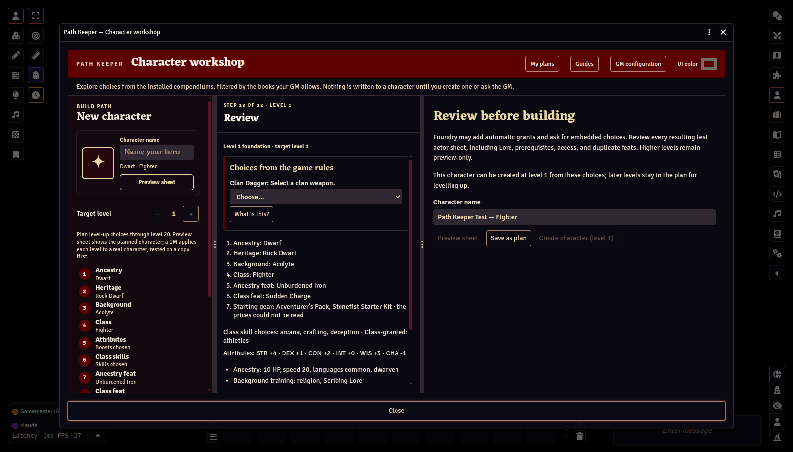

The middle pane starts with **Choices from the game rules**: questions the game system will need answered when the character is created. For a Dwarf, that is the clan weapon. The options come from PF2e itself. The create button stays disabled until every question is answered. See [PF2e rule choices](03-pf2e-rule-choices.md).

Below those, the middle pane summarises the build: every choice, attributes, skills, hit points, languages, and the class features you will receive. The right pane holds the character's name and the buttons that save or build it.

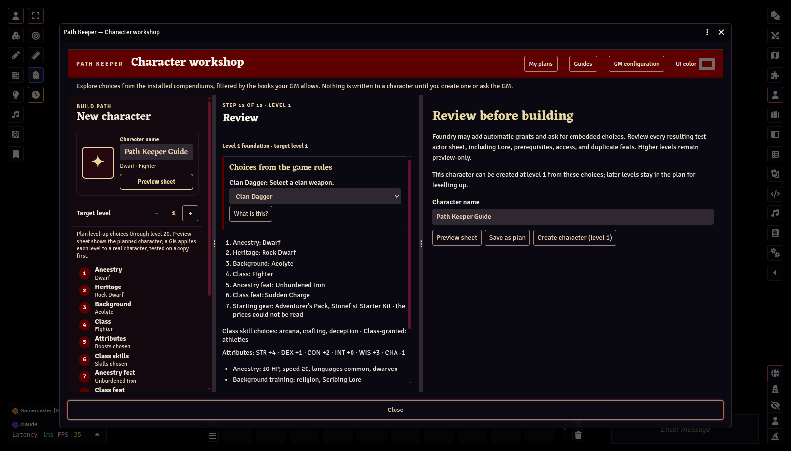

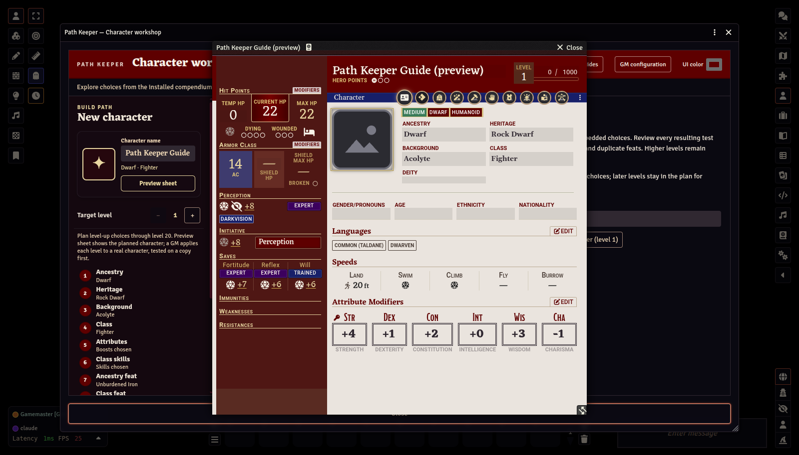

Name the character, then choose what to do with the build:

- **Preview sheet** (also in the workshop header) opens the character on the PF2e character sheet, exactly as it would be created, with every stat the system works out: hit points, AC, saves, skills, strikes, and spells. At a target level above 1, each planned level is applied the way a real level-up is (tested and checked), so the sheet shows the character at the target level; if a level cannot be applied yet, the preview shows the last one that could and says why (most often, a choice still to make on Level-up). Nothing is created; closing the sheet discards it, and you can open it any time without the GM.
- **Save as plan** keeps it on your account to come back to later.
- **Build sandbox character** (when your GM allows it) makes a private, playable copy.
- **Request promotion** asks the GM to create it as your real character.

See [Plans, sandbox characters, and promotion](04-plans-sandbox-promotion.md).

## The result

The new character opens in its PF2e sheet with everything applied by the system: ancestry, heritage, background, class and their granted features, both feats in their level-1 slots, trained skills, languages, background Lore, full hit points, the answered rule choices, the GM's starting equipment, and the gear you bought.

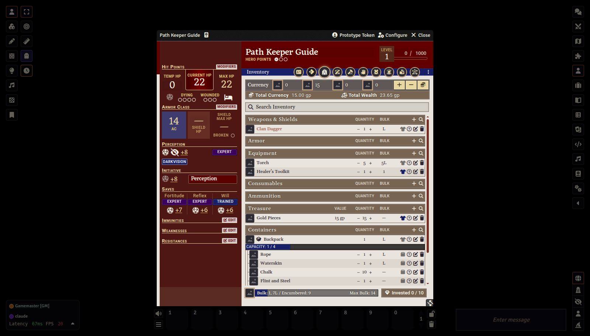

Here the Dwarf has the Clan Dagger chosen on the Review step, 15 gp, the contents of the *Adventurer's Pack*, and a custom GM kit.

Always look over a new character's sheet before play, especially Lore, prerequisites, and any feat that was marked for review.

Next: [PF2e rule choices →](03-pf2e-rule-choices.md)
