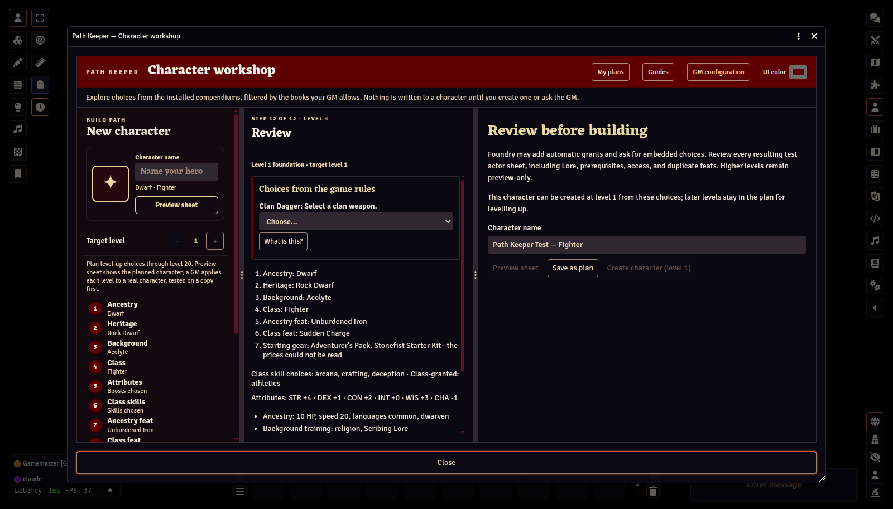
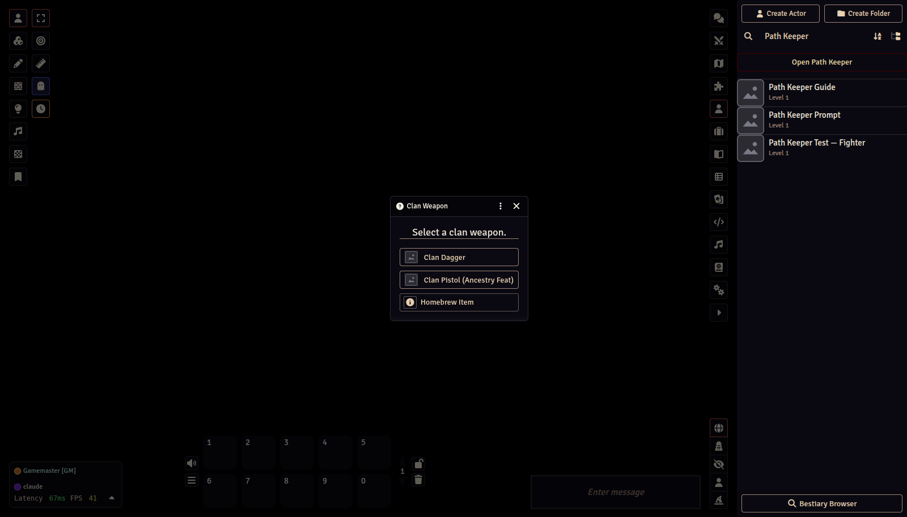

# PF2e rule choices

[← Player Guide contents](README.md)

Many PF2e ancestries, classes, and feats contain **rule elements**, small pieces of automation inside the item. One kind, the *ChoiceSet*, asks a question when the item is added to a character: a Dwarf's clan weapon, a Fighter's granted skill, a deity, a weapon group.

## What Path Keeper does

Path Keeper asks these questions on the **Review** step, before anything is created:

1. **The questions and options come from PF2e.** Path Keeper places your build on an unsaved scratch character, collects the features PF2e would grant, and asks each ChoiceSet for its options using the system's own logic. Filters, prerequisites, and compendium lookups are PF2e's, not Path Keeper's. Nothing is written.
2. **You answer them in the workshop.** Creation stays disabled until every answerable question has an answer.
3. **The answers are handed to PF2e.** When the character is created, PF2e finds each question already answered and applies it exactly as if you had picked it in its own prompt.

## Why this matters

Without this step, PF2e opens its own prompt during creation:

That is fine when you create your own character, but a player's character is created on the **GM's** computer. The prompt would appear on the GM's screen, and the GM would have to answer for the player. Collecting answerable choices in the workshop avoids those prompts; the exceptions below still need GM attention.

## Choices that appear after an answer

Some answers bring choices of their own: choosing the Animal Instinct asks which animal, choosing a deity settles a Cleric's Divine Font, a Wizard's thesis may grant a feat with a pick. After each answer, Review asks the game system again with everything answered so far, and any new choice joins the same list ("Checking whether this answer brings further choices…" shows while it does). Change an answer and the choices it brought disappear with it.

## Choices that cannot be answered in advance

A few choices belong to items two or more grants removed from anything Path Keeper creates directly (a dedication granted by a doctrine, say). Path Keeper cannot pre-answer those. The Review step lists them as:

> The game system will ask this when the character is created; player builds with it wait for the GM.

Every player submission waits for GM review. This choice is flagged in the request so the GM knows a PF2e prompt may still appear during creation.

## Choices Path Keeper already asks elsewhere

The Fighter's granted skill is asked on the **Class skills** step, and a Sorcerer's bloodline on the **Class path & spells** step, so they do not appear again on Review.

Next: [Plans, sandbox characters, and promotion →](04-plans-sandbox-promotion.md)
