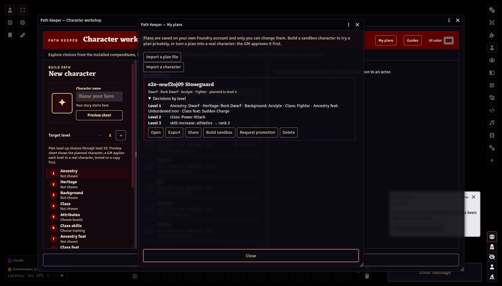
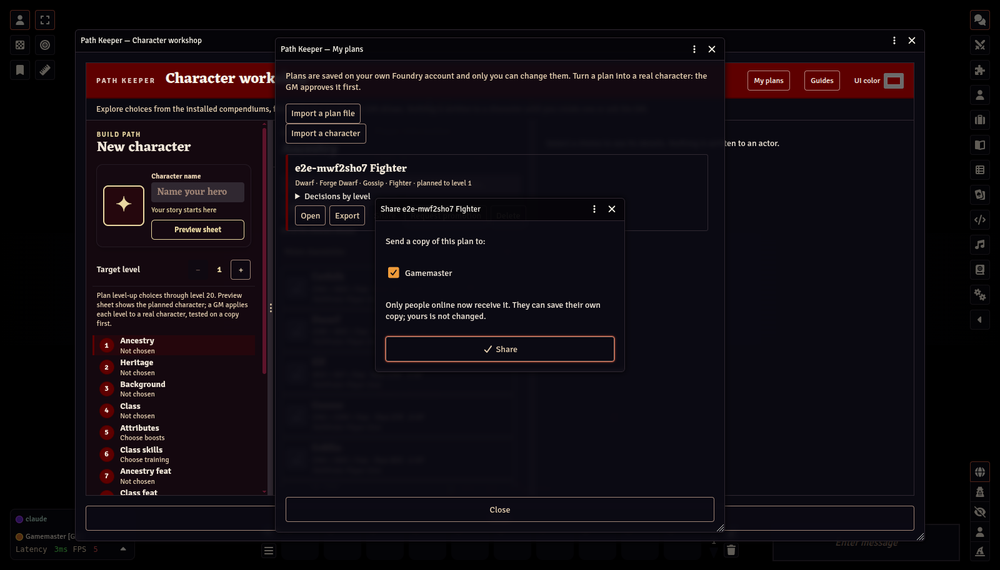
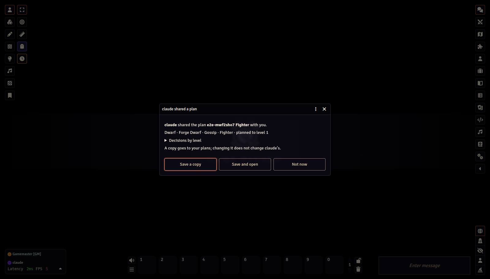
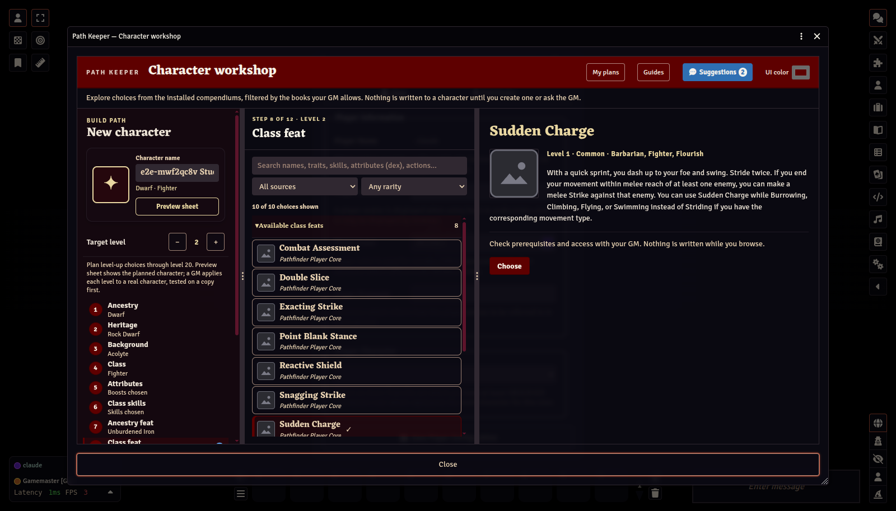
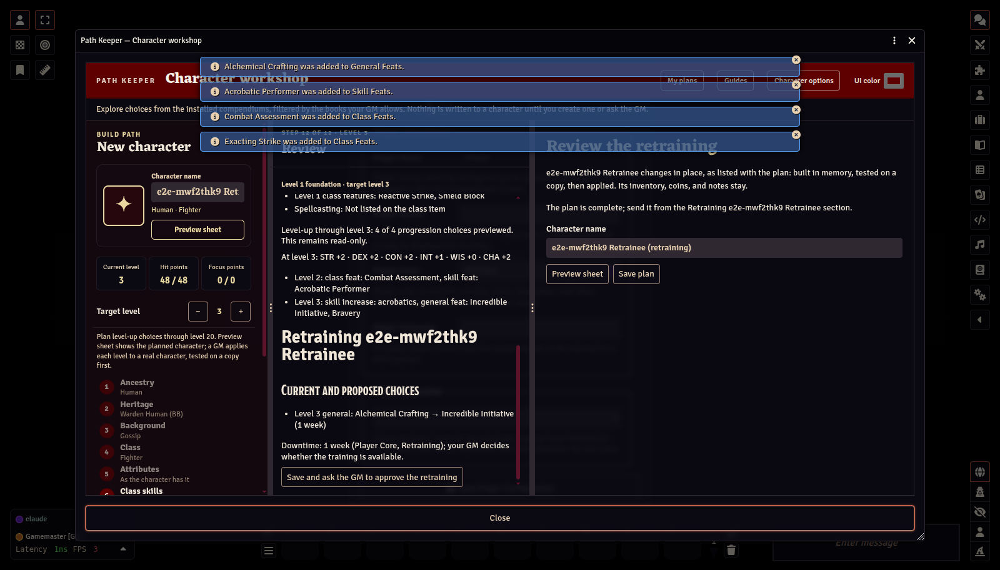

# Plans, sandbox characters, and promotion

[← Player Guide contents](README.md)

Players build characters as **plans**. A plan can go all the way to level 20. Plans are private drafts: try as many as you like, keep the ones you like, and ask the GM to **promote** one into your real character when you are ready.

Players never need Foundry's "Create New Actors" permission. Everything that creates an actor runs on the GM's client.
## Saving plans

On the **Review** step, **Save as plan** stores the current build on your own Foundry account. You can save at any target level, even before every step is finished. **My plans** in the workshop header lists your plans:

- **Decisions by level** shows what you chose at level 1 and at each later level.
- **Open** loads the plan back into the workshop so you can keep editing it.
- **Export** saves that one plan as a file (`<name>.path-keeper.json`), to keep, to bring to another world, or to give to another player.
- **Share** sends a copy to someone online now (see below).
- **Delete** removes the plan. Characters already built from it are not affected.

**Import a plan file** (at the top of My plans) adds a plan from such a file to your plans as a new plan. It must come from a world with the same game system (a Pathfinder plan into a Pathfinder world). Open it to see whether every pick is still allowed by this world's books; anything that is not is marked, as for any plan. A GM's approval does not travel with the file.

**Share** lists the other people online now; tick who should get a copy. Each of them sees the plan in a window, with what it is and its decisions by level, and can **Save a copy** to their own plans, **Save and open** it in the workshop, or choose **Not now**. Their copy is theirs: changing it does not change yours. Someone who is not online does not receive it; share again when they are, or send them an exported file. A plan imported at a character's level belongs to that character and cannot be shared.

Your GM can open your plans to help. If they change something, it arrives as a new plan marked **(GM suggestion)**, and you are notified. Your own plan stays as you left it. My plans lists exactly what the suggestion changes, and when you open either plan a blue **Suggestions** button in the workshop header lists each difference and marks the steps that hold them (a blue speech-bubble beside the yellow Attention mark). Selecting one opens that step; nothing changes until you choose it yourself.

Plans live on your Foundry user record. Foundry's server only lets you change your own record, which is how the GM knows a request really came from you.

## Sandbox characters

When the GM allows it, **Build sandbox** turns a plan into a real PF2e character you can open and play with, without asking for approval:

- It is built on the GM's computer through the same checks as any Path Keeper character, including your answers to PF2e's rule choices.
- It belongs to you, is hidden from the other players, and appears in a **Sandbox — your name** folder in the Actors directory.
- Its name starts with **[Sandbox]**. Delete it from the Actors directory when you are done; there is a per-player limit.

A GM must be connected for the sandbox character to be built. If none is online, your request waits and is built when a GM logs in.

## Asking for promotion

**Request promotion** (on the Review step or in My plans) asks the GM to create your real character from a plan. It works at any target level: the character is created at level 1 and the later levels stay in the plan. From My plans, the plan opens on its Review step first, and if anything is missing (a step, a rule choice) you are told what before anything is sent. The request carries a frozen copy of the plan, so the GM approves exactly what you submitted. You are notified when the GM decides.

If your GM does not require approval, the button reads **Create character**: the character is created as soon as a GM is connected. A plan with anything for the GM to decide (a yellow Attention note) still goes to the GM first.

**Once a promotion is approved, that plan is frozen for the character.** The GM keeps the approved copy where only GMs can change it. If you edit your plan afterwards, the change needs a new approval before it can be used for that character.

## Bringing in a character you already have

**Import a character** (at the top of My plans) brings a character you own into Path Keeper, for example when Path Keeper is added to a running game. Path Keeper rebuilds it as a plan from level 1 (ancestry, attribute boosts, skills, feats, each level's choices, and a spellcaster's spells) and checks that the plan gives exactly the same character. That makes it a check of the character too: anything the rules could not have produced is listed. The plan is saved under the character's name and linked to it; raise its target level to plan ahead.

A spellcaster's spells are read back level by level: the spells in a repertoire, spellbook, or familiar go to the levels that could have added them, and signature spells are the ones the character marks. A class that prepares from its whole list (a Cleric, a Druid) chooses its spells each day, so only its slots are checked. A spell learned another way (such as Learn a Spell) is named, since no level adds it.

If the character cannot be rebuilt from level 1, Path Keeper lists every reason and offers **Import at level N with current choices**: the plan starts where the character stands, and opening it shows the workshop on the character itself, with its build as it is and Level-up from its level. **Save as plan** keeps your choices.

To level the character from such a plan, use **Ask the GM to approve for …** in My plans. Once the GM approves it, apply its levels as below.

## Levelling up your character

When your character has gained a level, right-click it in the Actors directory and choose **Open in Path Keeper**, then **Open the workshop**, then **Character options → Apply approved level** in the workshop. That choice appears while your approved plan has a level beyond your character's. The window lists that level's decisions; **Test level N on a copy** builds the level from the approved plan and tests it on a copy kept in memory (nothing is created in the world). Only if the copy passes are you asked to apply it to your character. Repeat for each level. If a level cannot be applied, the window says why; your GM can help.

## Retraining your character

The rules let a character retrain in downtime (Player Core, Retraining): swap a feat for another of the same type, move a skill increase to another skill, or swap a skill you trained at creation. Each takes a week. Larger changes to a class feature, such as a druid order or a wizard school, take a month or more, and your GM decides whether any training is available. Ancestry, heritage, background, class, and attribute boosts cannot be retrained.

Right-click your character in the Actors directory, choose **Open in Path Keeper**, then **Open the workshop**, then choose **Character options → Retrain** in the workshop. Path Keeper reads the character back as a plan from level 1 and opens it in the workshop. What cannot be retrained is locked. Change a feat, a skill increase, a trained skill, or a repertoire spell at the level you took it; the later picks stay, and any that no longer qualify are marked so you can retrain them too.

The Review step lists each change and the downtime it takes. **Save and ask the GM to approve the retraining** sends it; once the GM approves, the character changes in place, tested on a copy first. It stays the same character, with its inventory, coins, notes, and what it prepared today, and the retrained plan becomes its approved plan for later levels. The plan also stays in My plans until it is applied, with the same button.

The character's home (**Open in Path Keeper**) offers shortcuts to the same retraining: **Stage a class feat swap**, **Stage a repertoire spell swap**, and **Stage class skill or Lore changes**. **Review staged changes** then opens them together on the Review step, where you send them to the GM as above.

Retraining needs the character to follow the rules (the same check as importing) and to rebuild exactly from level 1. If it does not, Path Keeper lists why; your GM can rebuild it instead.

## Rebuilding your character from level 1

**Character options → Rebuild from level 1** in the workshop opens the character's plan with every step open: walk through it level by level and change or correct anything. Your GM applies it, in place, the same way.

Importing a character that is against the rules opens the same rebuild, with each pick that is against the rules marked in red and listed on Review. A rebuild is sent, or applied, only when the character it makes follows the rules.

Next: [Planning ahead →](05-planning-ahead.md)
