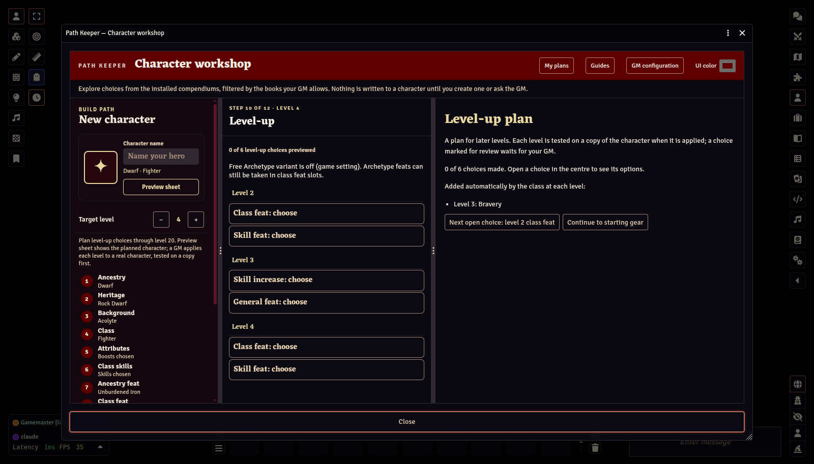
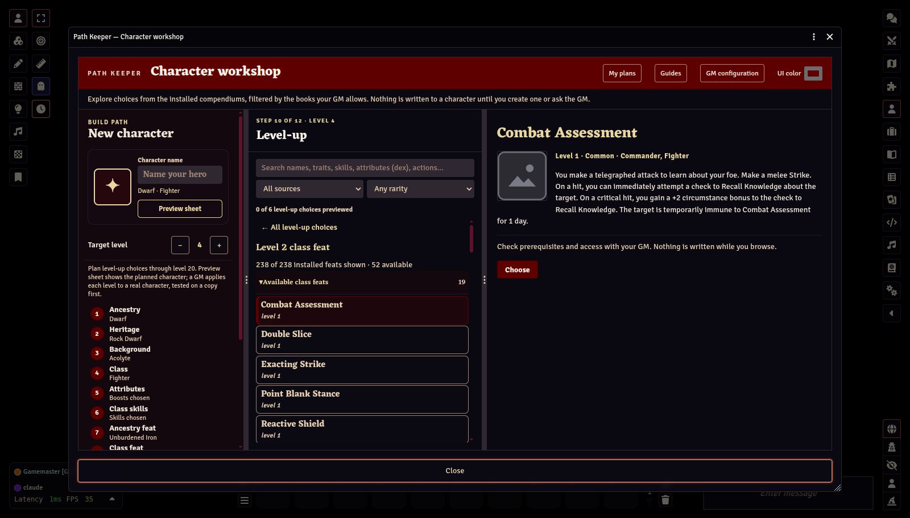

# Planning ahead

[← Player Guide contents](README.md)

## Bring in an existing character

In the Actors directory, right-click a character you own and choose **Open in Path Keeper**. Its home shows the character as it is now, by sheet section. **Open the workshop** there saves a plan from it; neither changes the character.

Path Keeper imports only characters that follow the rules, so it checks yours first: every feat is in a slot its class (or Free Archetype) has, of a kind that slot takes, and met its prerequisites at the level it was taken; a second dedication came after two other feats of the first archetype; each feat is taken no more often than it allows; the trained skills and skill increases fit what the build allows (raising Intelligence trains one more skill and teaches a language); and the spell list is the kind the class uses. If something is against the rules, Path Keeper lists each problem in plain words and offers **Open in Path Keeper to fix these**: the character opens as a rebuild from level 1 (see *Rebuilding your character from level 1*), with each pick that is against the rules marked in red. Choose those again; a red mark goes as soon as its pick changes. The character changes only once nothing is against the rules: Path Keeper builds the rebuild in memory and checks it the way an import does, and your GM approves it. You can also correct the sheet yourself and import it again. Some things only the GM can allow, such as a rare feat, a feat from a book this world's settings leave out, or a bonus feat nothing grants; they stop the import only if your GM has set Path Keeper to ask about them, and then your GM imports the character for you. Choices not made yet, such as an empty feat slot or an unspent skill increase, are listed but do not stop the import.

Path Keeper then tries to reconstruct its history from level 1 and compare the result with the sheet. If that cannot be verified, choose **Import at level … with current choices** to keep the sheet as the starting point and plan only future levels. Click the earlier build categories to inspect the character's recorded choices; they are read-only. Raise **Target level** to 9 or 10, make the Level-up choices, and save the plan. A GM can test each planned level on a separate copy before applying it to the character.

If an expected option is missing, ask the GM to allow its source book and enable its compendium. An imported item from a missing module stays on the existing sheet, but Path Keeper cannot offer new items from a pack that is not installed. A character with two class items or a spell list that disagrees with its class needs a GM to check a backup copy first; Path Keeper will not guess which class or list to change.

Raise the **Target level** in the build path (up to 20), then open the **Level-up** step. It opens on an overview of every level's choices; the right pane lists what the class adds by itself at each level.

Select a choice to list its options in the middle pane, with search and filters. Select an option to read it on the right; **Choose** takes it and moves on to the next open choice. **← All level-up choices** returns to the overview.

A feat with a choice of its own (Assurance's skill, Skill Training's skill) asks it right under the pick as **Choices &lt;feat&gt; brings**, the same way Review asks the game system's level-1 choices. The answer is kept with the slot, shows on Review as "Assurance (Athletics)", and an unanswered one appears in Attention until it is settled.

Path Keeper lists every advancement slot up to the target level: class feats, skill feats, general feats, ancestry feats, skill increases, and the attribute boosts at levels 5, 10, 15, and 20. A class with a skill feat at 1st level (the Rogue) chooses it here too, as the first choice; Level-up is open for it even at level 1. When a level's boosts raise your Intelligence modifier, you also become trained in a skill and learn a language (Player Core, Leveling Up); that attribute slot then asks for both, a skill from the list or a Lore you name, and a language. A skill increase can raise a Lore you are trained in. Some class features add increases of their own: a Swashbuckler's Stylish Tricks adds one at 3rd, 7th, and 15th level for Acrobatics or the style's skill, and its skill feats at those levels must be for one of those skills. Class feat slots also offer archetype feats, marked **archetype** in the list, since an archetype feat can be taken in place of a class feat. If your GM has turned on the **Free Archetype** variant in the game's settings, an extra archetype slot appears at every even level; the Level-up step says whether the variant is on. A second dedication chosen before two feats from the first archetype is marked for the GM to check. The slots come from PF2e's own feat groups, so variant rules such as **Free Archetype** add their slots automatically. A class feature that brings a choice of its own at its level (a Fighter's weapon mastery group at 5, a Monk's path to perfection at 7) is a choice on that level too, listed first: select it, read each option on the right, and **Choose**.

To see the planned character at the target level, use **Preview sheet** on Review: it applies each planned level and opens the result on the character sheet, without creating anything.

A slot lists the eligible feats first; simple skill prerequisites are checked, and anything else is marked for review. A spellcaster also gets a **new spells** choice at each level that adds spells: it lists the spells to pick in the middle pane, and the right pane says which slots the level opens and which spells it adds automatically. An Animist attunes its third and fourth apparitions there (at 7 and 15). An Oracle's Divine Access at 11 is there too: choose a deity that grants one of your mystery's domains, then up to three of its cleric spells. A spell of a rank you cannot cast yet joins your repertoire when you can.

A class whose repertoire lets it swap spells (a Bard, Sorcerer, Oracle, Psychic, or Summoner, as its Spell Repertoire feature says) can also, at a level that adds spells, **swap out** one spell it already knows and **swap in** a different spell of the same rank. Both are optional; choose the spell to give up first, then its replacement. Spells the class grants (a bloodline's, for example) are not offered. Swapping at other times is retraining, which takes downtime and your GM's agreement.

An Alchemist gets a **new formulas** choice at each level from 2: pick two common alchemical items of that level or lower for your formula book.

A few things are not stored by the game system, so the Level-up overview lists them to record on the sheet by hand: a Runesmith's new runes as its repertoire grows, and a Summoner's Eidolon Transcendence at 17, which changes the eidolon.

This preview is for planning. It does not write anything.

Save the plan to keep every level's decisions. **My plans → Decisions by level** shows what you chose at each level.

When your character is promoted, the GM approves the plan as it was at that moment. Later changes to the plan need the GM's approval again before they can be used for that character.

Next: [Troubleshooting →](06-troubleshooting.md)
